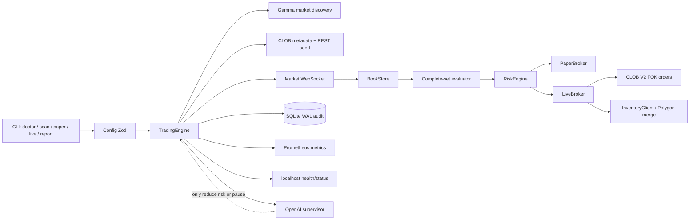
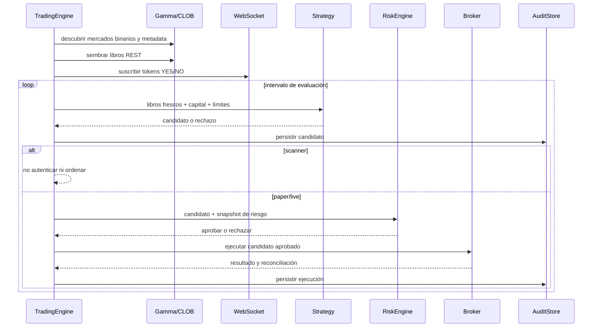

# Arquitectura implementada

## 1. Propósito y límite

Alberdi es un motor determinista de arbitraje de conjuntos completos para mercados binarios estándar de Polymarket. Compra cantidades iguales de YES y NO únicamente cuando el valor de fusión esperado supera el costo ejecutable total después de profundidad, taker fees y reserva de seguridad.

No predice resultados, no usa apalancamiento, no promedia pérdidas y no permite que un modelo apruebe una operación rechazada por los límites duros.

## 2. Vista de componentes

## 3. Responsabilidades

| Área | Responsabilidad principal |
|---|---|
| `src/config.ts` | Validación fail-fast de entorno y gates de live/OpenAI |
| `src/polymarket/` | Descubrimiento, metadata, libros, WebSocket e inventario |
| `src/strategy/` | Evaluación de profundidad ejecutable, fees, reserva y sizing |
| `src/risk/` | Límites duros independientes del supervisor |
| `src/execution/` | Contrato de broker, simulación y ejecución real |
| `src/service/engine.ts` | Orquestación, timers, cooldown, pausa y shutdown |
| `src/infrastructure/` | Logs, SQLite y persistencia de evidencia |
| `src/agent/` | Supervisión periódica no crítica para latencia |

## 4. Flujo de mercado y decisión

## 5. Ejecución live

`LiveBroker` admite únicamente firma EOA (`POLYMARKET_SIGNATURE_TYPE=0`). Antes de construir el cliente:

1. exige clave privada y acknowledgement explícito;
2. consulta el endpoint de geoblocking;
3. usa credenciales CLOB existentes o las deriva en memoria;
4. actualiza balance/allowance de collateral;
5. toma balances iniciales de pUSD, YES y NO;
6. crea ambas órdenes desde el mismo candidato;
7. envía ambas como FOK en una misma llamada de batch;
8. espera cambios de balances;
9. fusiona la cantidad mínima emparejada;
10. calcula PnL por delta real de collateral;
11. devuelve `COMPLETED`, `PARTIAL` o `FAILED`.

El batch no garantiza atomicidad cruzada entre ambas piernas. FOK protege cada orden por separado. Cualquier resultado parcial pausa el motor.

## 6. Separación del supervisor OpenAI

El supervisor recibe estadísticas agregadas, errores recientes, candidatos recientes y snapshot de riesgo. Sus acciones permitidas son continuar, reducir el multiplicador de riesgo o pausar.

No puede:

- cambiar máximos configurados;
- aprobar una operación rechazada por `RiskEngine`;
- crear órdenes;
- recibir claves privadas o credenciales CLOB;
- operar en el loop de cotización de baja latencia.

## 7. Persistencia y observabilidad

- SQLite en `DATA_DIR` conserva candidatos, ejecuciones, decisiones y eventos.
- El proceso recupera PnL realizado desde la auditoría al iniciar.
- Los endpoints `/health`, `/status` y `/metrics` se exponen únicamente en localhost por Compose.
- El cierre por SIGINT/SIGTERM detiene timers, WebSocket, servidor, auditoría e intenta `cancelAll` en live.

## 8. Invariantes

- Scanner nunca instancia un broker autenticado.
- Live requiere wallet EOA dedicada y acknowledgement literal.
- La estrategia usa profundidad ejecutable, no solo best ask.
- Los límites duros no pueden ser aumentados por IA.
- Partial fill siempre provoca pausa.
- El motor no compra la pierna faltante a cualquier precio.
- El objetivo de capital no puede debilitar riesgo.
- La evidencia SQLite es parte del producto, no un log descartable.

## 9. Limitaciones conocidas

- No existe transacción atómica entre las dos órdenes CLOB.
- La aceptación de settlement real depende de wallet, allowances, RPC y contratos externos.
- Las credenciales derivadas en memoria deben persistirse manualmente para operación estable.
- La recuperación de una posición residual requiere revisión humana.
- La viabilidad económica depende de oportunidades reales después de todos los costos.
