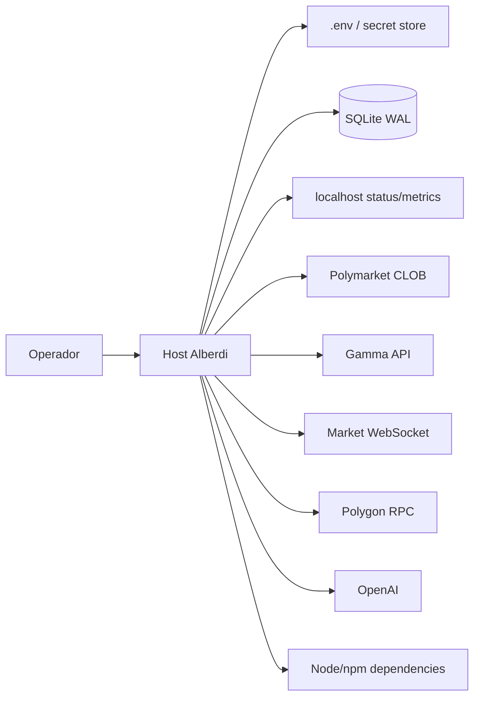

# Modelo de amenazas

## 1. Alcance

Este documento cubre la máquina de ejecución, configuración, wallet EOA, credenciales CLOB/OpenAI, conexiones externas, SQLite, logs, status server y operador.

No supone que Polymarket, Polygon, RPC, OpenAI o la red local sean confiables por defecto.

## 2. Activos críticos

- private key de la EOA;
- pUSD, POL y conditional tokens;
- credenciales CLOB y relayer;
- API key de OpenAI;
- configuración de límites;
- SQLite/WAL como evidencia financiera;
- IDs de órdenes y hashes de transacciones;
- integridad del código y dependencias;
- capacidad de detener el proceso.

## 3. Trust boundaries

Cada flecha que sale del host cruza una frontera externa. Las respuestas deben validarse, limitarse y reconciliarse.

## 4. Amenazas principales

### T1. Exposición de private key

**Impacto:** pérdida total del bankroll.

**Vectores:** `.env` permisivo, logs, shell history, backups, imágenes, malware, clipboard o prompts.

**Controles:** EOA dedicada, permisos `0600`, secretos fuera de Git, redacción, host restringido, retiro y rotación ante sospecha.

### T2. Manipulación de configuración

**Impacto:** límites elevados o live habilitado sin autorización.

**Vectores:** acceso al host, CI/artefacto comprometido, archivo `.env` reemplazado.

**Controles:** Zod fail-fast, acknowledgement literal, signature type EOA, revisión de diff, checksums/artefactos reproducibles y permisos del host.

### T3. Datos de mercado stale o falsos

**Impacto:** candidato rentable en cálculo pero negativo al ejecutar.

**Vectores:** WebSocket congelado, REST inconsistente, MITM/DNS comprometido, reloj incorrecto.

**Controles:** HTTPS/WSS, REST seed, staleness checks, metadata dinámica, safety reserve, doctor y reloj sincronizado.

### T4. No atomicidad de las dos piernas

**Impacto:** exposición direccional residual.

**Vectores:** una FOK settlea y la otra no, timeouts, estado ambiguo.

**Controles:** batch submission, balances antes/después, merge de cantidad emparejada, pausa en partial y reconciliación manual.

### T5. RPC o settlement engañoso/inconsistente

**Impacto:** doble acción, PnL incorrecto o residual no detectado.

**Controles:** receipts, balances en cadena, no reintentos ciegos, múltiples fuentes para investigación y pausa ante ambigüedad.

### T6. Dependencia o SDK comprometido

**Impacto:** robo de secretos, órdenes alteradas o ejecución arbitraria.

**Controles:** lockfile, versiones fijadas donde sea posible, revisión de cambios, `npm ci`, auditoría de dependencias, builds desde commits conocidos y host no compartido.

### T7. Supervisor OpenAI incrementa riesgo o filtra secretos

**Impacto:** decisiones inseguras o exposición de credenciales.

**Controles:** estado agregado, sin claves, schema estricto, acciones limitadas, multiplicador solo reductor y límites duros independientes.

### T8. Status server expuesto

**Impacto:** fuga operativa o superficie de ataque.

**Controles:** bind localhost, puerto no publicado externamente, firewall y ausencia de secretos en respuestas.

### T9. Manipulación o pérdida de auditoría

**Impacto:** imposibilidad de reconciliar capital o investigar incidentes.

**Controles:** SQLite WAL persistente, backups con checksum, permisos, restore drill y preservación forense.

### T10. Doble instancia con la misma wallet

**Impacto:** sizing incorrecto, balances de baseline inválidos y carreras de órdenes.

**Controles:** operación de instancia única, verificación de procesos/servicios y asignación exclusiva de wallet por deployment.

### T11. Evasión de geoblocking

**Impacto:** incumplimiento legal/contractual y bloqueo de cuenta/fondos.

**Controles:** doctor/live consultan geoblock; prohibición explícita de bypass; detener ante bloqueo.

### T12. Error del operador

**Impacto:** fondos excesivos, límites mal configurados, restore incorrecto o reinicio de un estado parcial.

**Controles:** ladder de capital, checklists, documentación, acknowledgement, runbooks y reconciliación antes de reanudar.

## 5. Riesgos residuales aceptados

- No hay atomicidad cruzada garantizada por Polymarket.
- Un proveedor externo puede cambiar contrato, fee, respuesta o disponibilidad.
- La wallet puede perder valor por una operación residual manual.
- El safety reserve reduce pero no elimina slippage, latencia o desincronización.
- La rentabilidad futura no se deriva de resultados de paper o pruebas históricas.

## 6. Controles pendientes recomendados

- CI con `npm audit`/escaneo de secretos y SBOM;
- firma/checksum de artefactos de release;
- lock de instancia por wallet;
- alertas externas para `paused`, partial y proceso caído;
- backup automatizado cifrado;
- verificación de integridad de DB;
- runbook automatizado de reconciliación read-only;
- pruebas de caos para desconexión entre envío, settle y merge.
