# 04 — Diagramas UML

## Propósito

Yo uso UML para mostrar el sistema desde distintos puntos de vista. Un único diagrama no puede explicar actores, estructura, comportamiento, despliegue y estados al mismo tiempo.

Los diagramas están escritos en Mermaid para que GitHub pueda renderizarlos y para que los cambios se revisen junto con el código.

## Cobertura UML 2

| Tipo de diagrama | Cobertura | Uso en Alberdi |
|---|---|---|
| casos de uso | incluido | objetivos del operador y sistemas externos |
| clases | incluido | entidades y servicios principales |
| objetos | incluido | snapshot concreto de una oportunidad |
| componentes | incluido | módulos ejecutables |
| paquetes | incluido | dependencias del código |
| estructura compuesta | incluido | interior del motor de trading |
| despliegue | incluido | proceso, servicios y red |
| actividad | incluido | evaluación y ejecución |
| máquina de estados | incluido | ciclo operativo |
| secuencia | incluido | operación live |
| comunicación | incluido | mensajes entre colaboradores |
| visión general de interacción | incluido | encadenamiento de flujos |
| temporal | incluido | ventanas y frescura |
| perfil | incluido | estereotipos de seguridad y criticidad |

## 1. Casos de uso

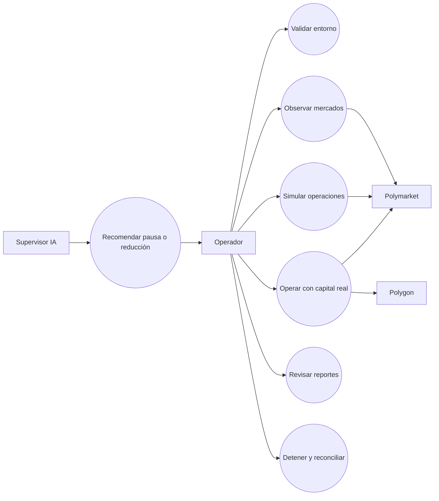

## 2. Clases de dominio y servicios

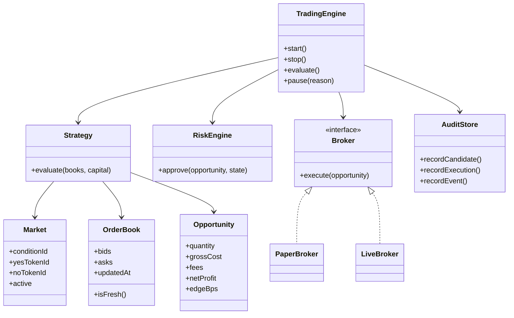

## 3. Objetos en una evaluación concreta

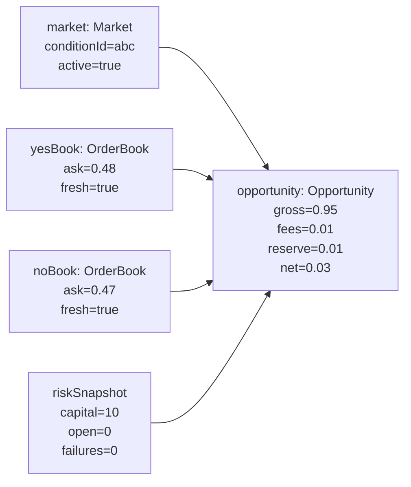

Los valores son ilustrativos; no representan una oportunidad garantizada.

## 4. Componentes

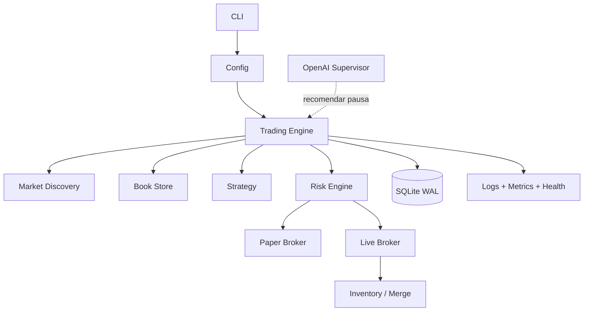

## 5. Paquetes

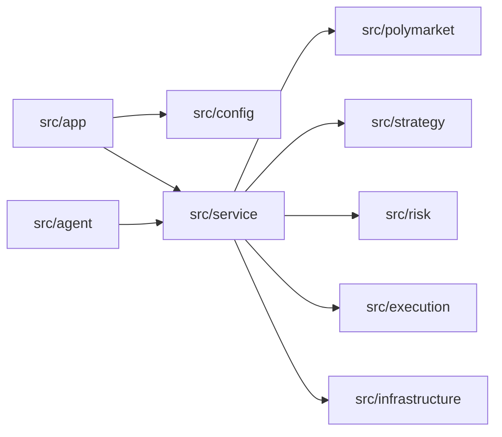

Yo mantengo estrategia y riesgo independientes de los adaptadores externos para poder probarlos sin red.

## 6. Estructura compuesta del motor

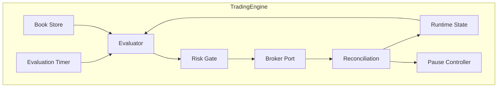

## 7. Actividad de evaluación

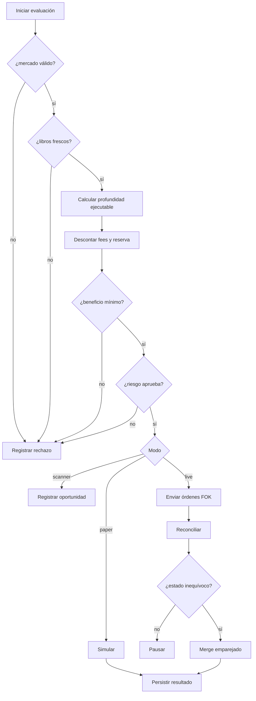

## 8. Máquina de estados operativa

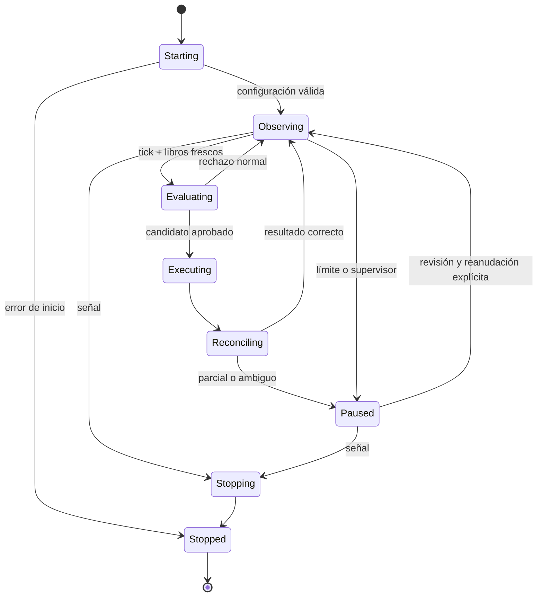

## 9. Secuencia live

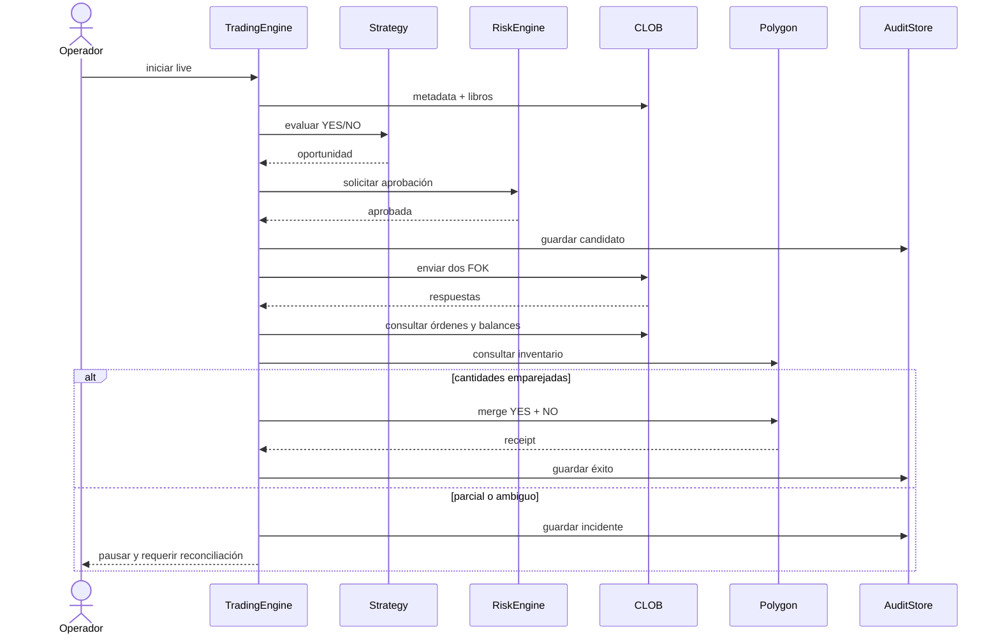

## 10. Comunicación entre colaboradores

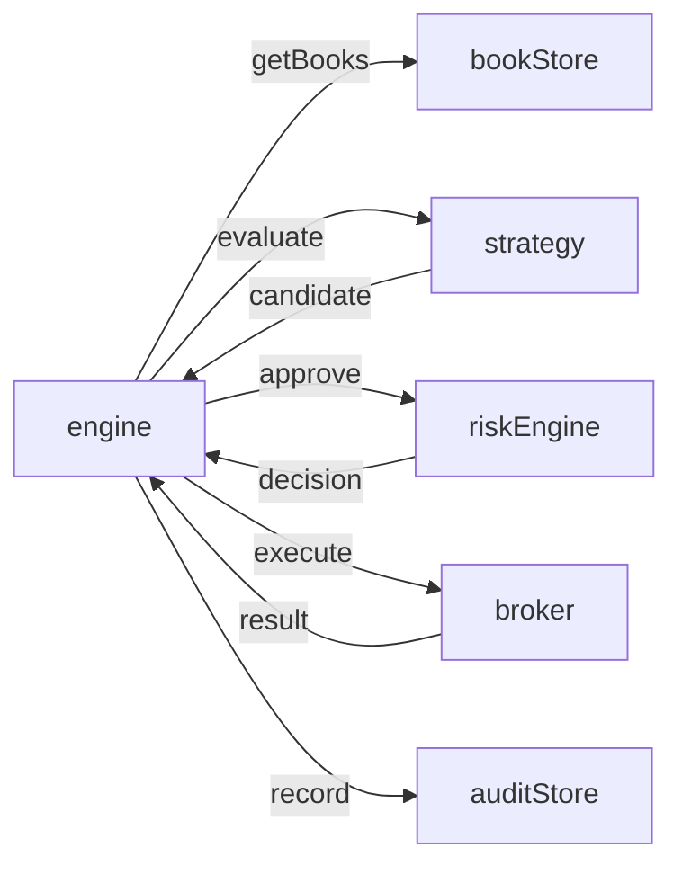

La numeración de mensajes no se fija en el diagrama porque el orden detallado está representado en el diagrama de secuencia.

## 11. Visión general de interacción

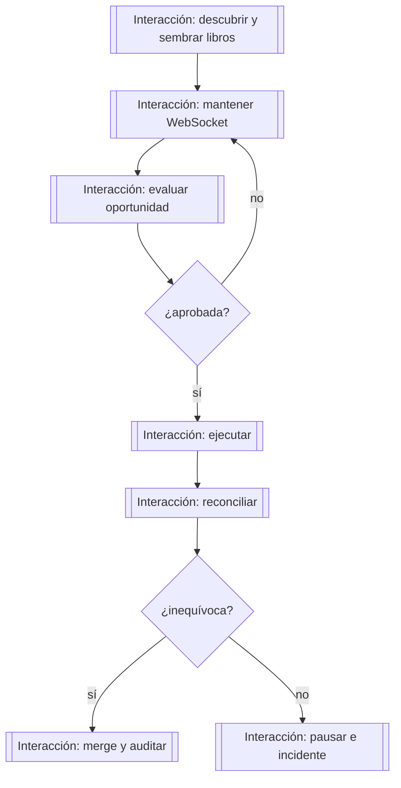

## 12. Diagrama temporal

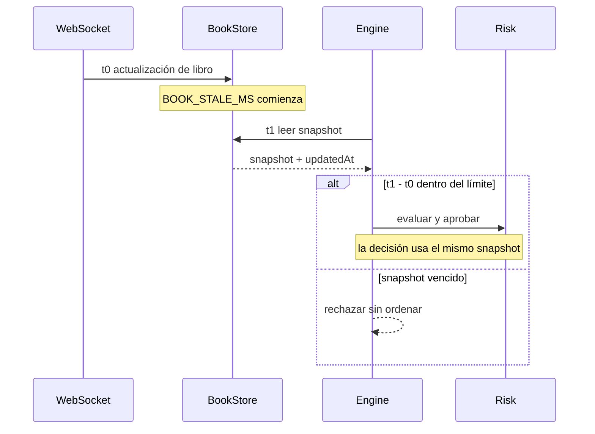

## 13. Despliegue

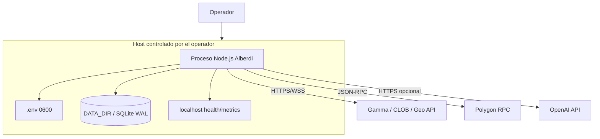

## 14. Perfil UML de criticidad

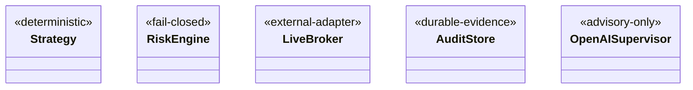

Yo uso estos estereotipos documentales para señalar reglas que no deben romperse durante refactors.

## Regla de mantenimiento

Cuando cambio actores, módulos, estados, despliegue o interacciones, yo actualizo el diagrama afectado en el mismo pull request. Un diagrama que contradice el código se considera defectuoso.